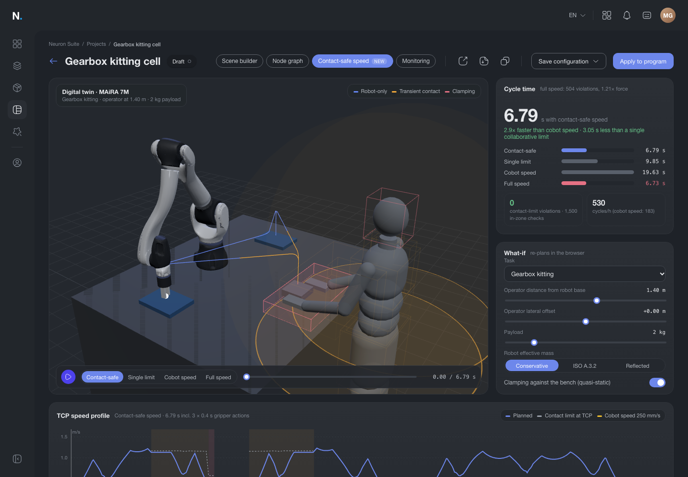

# Contact-safe speed for MAiRA (Neuron Suite concept)

**Live demo:** https://mohith26.github.io/neura-contact-safe-speed/

MAiRA's collaborative mode today is a key switch: position I caps the robot at 250 mm/s everywhere, position II allows up to 4.5 m/s (MAiRA user manual 09/2024, section 7.2). Contact-safe speed replaces that binary choice with a plan. It works out which body region of the operator each point of the arm could touch along the path (ISO/TS 15066 Annex A), turns each region's force, pressure, stiffness and mass into a speed limit for that point, and folds those limits into a time-optimal trajectory together with MAiRA's own joint speed and torque limits. An independent verifier then re-checks every point at 4x the planning resolution. On a synthetic gearbox-kitting cell built on NEURA's published MAiRA 7M model, the plan runs a kit in **6.79 s instead of 19.63 s** at cobot speed (2.9x), with **0 contact-limit violations**. Running at full speed instead would exceed the permissible force near the operator at 504 checked points (peak 1.21x the limit).



## How it works

1. **Robot model.** Kinematics, link masses, centres of mass, inertias, joint speed and torque limits are NEURA's own MAiRA 7M description, published on PyPI as `neura-rtb-data` 0.0.1 (`maira7M_*_nominal.xacro`). The 3D view uses the same package's collision meshes, vertex-clustered to 33k triangles. `src/kin.js` implements forward kinematics, point Jacobians, the joint-space mass matrix, recursive Newton-Euler inverse dynamics and the reflected mass `m_u = 1 / (u^T J M^-1 J^T u)`.
2. **Path.** Each motion is a Cartesian polyline with blended corners (tool pointing down), sampled every 5 mm, solved with damped-least-squares IK (A3 and A7 held, so the joint path is unique and smooth) and fitted with a C2 joint spline parameterized by TCP arc length.
3. **Body-region zones.** From the operator's position the cell derives ISO/TS 15066 Table A.2/A.3 regions: head (keep-out), neck, chest, abdomen, pelvis, upper arms, lower arms, hands, thighs and lower legs, plus a reach envelope (arm length + 10 cm for leaning) in which a hand or forearm can appear anywhere. Contact is **quasi-static (clamping)** when a point moves down toward the bench within 6 cm of it, otherwise **transient** (2x force, no transient contact allowed for head and face).
4. **Speed limit per point.** For each of seven watched points (shoulder, upper arm, elbow, forearm, wrist, flange, gripper tip) the limit is `v = F_lim / sqrt(mu k)`, with `F_lim = multiplier x min(F, p x A)`, `mu = (1/m_H + 1/m_R)^-1`. By default `m_R` is the larger of ISO's simplified `M/2 + m_L` and the model-based reflected mass along the direction of motion.
5. **Time-optimal parameterization.** TOPP-RA (Pham and Pham, 2018): a backward pass computes the controllable set of `sdot^2` at every stage (2-variable LPs over joint torque, assumed joint acceleration and all velocity limits), and a forward pass takes the largest admissible acceleration. The result is time-optimal for the discretized problem, and infeasibility (for example a path through the head keep-out) is reported exactly instead of being slowed around.
6. **Verifier.** `verifyMotion` replays the closed-form `s(t)` at 4 points per grid interval on the exact (non-inflated) zones and checks contact speed, predicted force, joint speed and torque. The planner works to 97% of each contact limit with zones inflated by 1 cm, so discretization cannot push a sample over.

## Results (synthetic cell, NEURA's published MAiRA 7M model, 2 kg payload)

Reproduce with `node scripts/build-results.mjs` (writes `data/results.json`; the headline numbers are asserted by the tests and by CI).

| Gearbox kitting (3 motions + 3 x 0.4 s gripper actions) | Cycle time | Contact-limit violations (4x verifier) | Peak force / limit |
|---|---:|---:|---:|
| Cobot speed (key switch I, TCP <= 250 mm/s) | 19.63 s | 0 | 0.43 |
| Single collaborative limit (strictest region everywhere) | 9.85 s | 0 | 0.52 |
| **Contact-safe speed** | **6.79 s** | **0** | 0.97 |
| Full speed (key switch II, robot limits only) | 6.73 s | 504 | 1.21 |

| Hand-over to operator | Cycle time | Violations |
|---|---:|---:|
| Cobot speed | 11.45 s | 0 |
| Contact-safe speed | 4.31 s | 0 |
| Full speed | 4.27 s | 387 |

What the numbers say: on this cell almost all of the cobot-speed penalty is avoidable. The contact limits cost 0.07 s against full speed, because the arm is within the operator's reach for only about a quarter of the moving time and MAiRA's joint limits already bind elsewhere. In the downward place motion the model-based reflected mass (43.8 kg) is larger than ISO's simplified `M/2 + m_L` (30.7 kg), which is why the conservative setting takes the larger of the two.

## The app

A static page in the Neuraverse app shell (tokens sampled from the Creator Hub recording on neuraverse.com, Iconsax icons as in the production app): digital twin with playback of all four strategies, cycle-time comparison, TCP speed profile with the per-point contact envelope, a segment table with a drill-down that shows every step of the ISO/TS 15066 calculation, and what-ifs (task, operator position, payload, mass model, clamping) that re-plan in a Web Worker in about 0.3 s. "Apply to program" records the applied plan (localStorage), the URL deep-links the full state, CSV/JSON export, keyboard shortcuts (`?`).

## Run

```bash
python3 -m http.server 8000   # then open http://localhost:8000
node --test test/*.test.mjs   # 17 tests: dynamics identities, ISO/TS 15066 numbers, TOPP-RA optima, randomized property tests, headline reproduction
node scripts/build-results.mjs
node scripts/meshes.mjs <dir with Link*_body.stl>   # regenerate the decimated meshes
```

No build step and no dependencies; Three.js is loaded from a CDN.

## Honest limitations

- **Synthetic cell and task.** The bench, trays, fixture, operator anthropometry and paths are made up; only the robot model and the ISO/TS 15066 values are real.
- **Nominal dynamics.** Some published inertia values look like conservative placeholders (for example 17.5 kg m^2). Joint acceleration limits are not published and are assumed (6 to 16 rad/s^2). Neither affects the contact limits under the ISO mass model.
- **Annex A is informative.** Speed limits from the energy model are a design aid. Quasi-static (clamping) contacts in particular must be measured on the real cell, which is what NEURA's safety test team does. The output is a plan to validate, not a certificate.
- **Contact geometry.** Seven points with housing radii stand in for the full arm surface; the gripper's contact area (1.5 cm^2) is a guess, and pressure binds only below about 1 cm^2.
- **Offline only.** This plans speeds for a known layout. MAiRA's touchless human detection could switch between precomputed profiles online; that is not modelled here.

## Prior art and what is new

Velocity limits from ISO/TS 15066 are well studied: Haddadin et al.'s Safe Motion Unit (ICRA 2012) maps injury data to safe speed for a given reflected mass; Lucci et al. (RA-L 2020) enforce the limits with control barrier functions online; the COVR RACOS project (2021) computes one "maximum allowed collaborative speed" per body region for risk assessment; Universal Robots exposes TCP and elbow speed limits in its safety configuration. What I could not find, in MAiRA's user and software manuals, on neuraverse.com (Neuron Suite, Creator Hub, Marketplace) or in NEURA's news, is an offline planner that derives the limits from a cell layout per point and per body region, folds them into a time-optimal parameterization with the robot's own torque limits, compares ISO's simplified mass with the model's reflected mass, and verifies the result independently. MAiRA today offers collision detection, a 0-100% speed override, joint speed limits and the 250 mm/s key switch.

---

Unofficial concept demo by Mohith Gajjela. Not affiliated with NEURA Robotics. Robot model from NEURA's public `neura-rtb-data` package; cell and task are synthetic.
